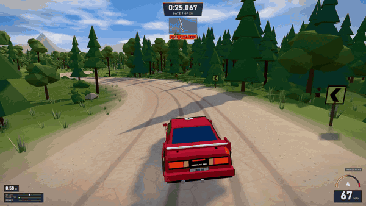
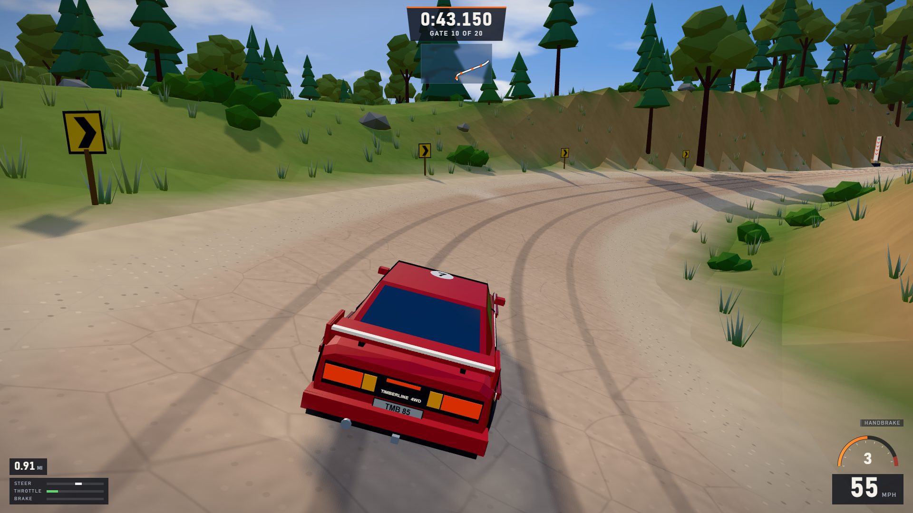
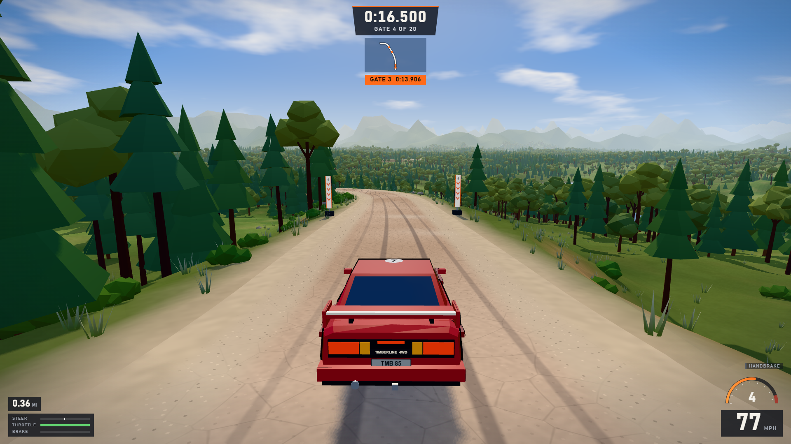
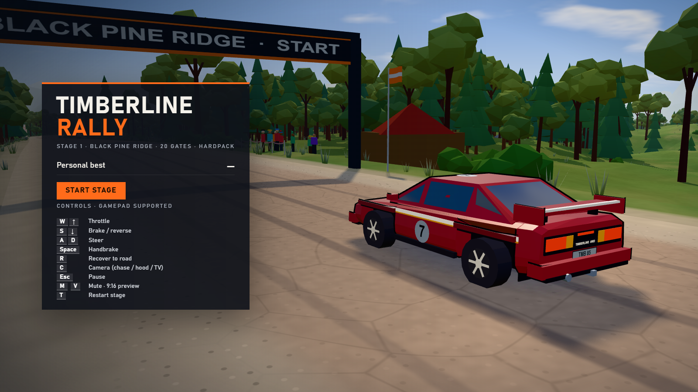

# Timberline Rally

A small arcade rally game that runs in your browser. One car, one forest stage, twenty gates and a clock.



You drive a red 80s rally coupe down Black Pine Ridge, a 3.1 km gravel stage through pine and oak forest, and try to post the fastest time through all 20 gates. A clean run takes about a minute and a half.

Everything in the game is generated in code: the car, the trees, the road, the sky and the engine sound. There are no image, model or audio files to load.

## What's in it

- A full stage with two jumps, a banked hairpin, fast sweepers, tight hairpins and a view down to a lake
- Hand-written car physics with suspension on every wheel, grip that changes between gravel and grass, weight transfer, handbrake turns and proper airtime
- Chase, bonnet and trackside TV cameras
- Dust, tyre marks, brake lights and backfire flashes
- An engine sound built on the fly, plus a little turbo whistle
- Gate splits, a personal best, a local top 5 and a ghost car of your best run
- Keyboard or gamepad, MPH or km/h, three graphics presets and two levels of driving assists
- A 9:16 portrait mode if you want to record vertical clips

## Screenshots

| | |
|---|---|
|  |  |
|  |  |

## Controls

| Action | Keyboard | Gamepad |
|---|---|---|
| Accelerate | W or Up | Right trigger |
| Brake, or reverse when stopped | S or Down | Left trigger |
| Steer | A and D, or Left and Right | Left stick |
| Handbrake | Space | A or RB |
| Put the car back on the road | R | Y |
| Change camera | C | X |
| Pause | Esc or P | Start |
| Restart the stage | T | Back |
| Ghost on or off | G | |
| Switch MPH and km/h | U | |
| Fullscreen | F | |
| Mute | M | |
| Portrait preview | V | |

The pause menu also lets you change the graphics quality and pick between arcade and pro assists. Arcade helps you catch slides and makes handbrake turns easier. Pro gives you the raw car.

## Running it locally

You'll need Node.js 20 or newer and a browser with WebGL2, such as Chrome, Edge or Firefox.

```bash
cd rally-game
npm install
npm run dev
```

Then open http://127.0.0.1:5173 and press **Start stage**.

On an RTX 3050 laptop it runs at around 120 fps at 1080p. If your machine struggles, the game drops its own quality setting after a few seconds, or you can pick one in the pause menu.

## Building

```bash
cd rally-game
npm run build
```

The finished game goes into `rally-game/dist`. It's a plain static site, so any web host can serve it. Opening `index.html` straight from your disk won't work, because browsers block JavaScript modules on `file://` addresses. Use `npm run preview` to try the built version locally.

## Putting it on itch.io

1. Build the game with `npm run build` inside `rally-game`.
2. Zip the contents of the `dist` folder, not the folder itself, so `index.html` sits at the top of the zip. In PowerShell that's:

   ```powershell
   Compress-Archive -Path dist\* -DestinationPath timberline-rally.zip -Force
   ```

3. Create a new project on itch.io, set the kind of project to HTML and upload the zip.
4. Tick "This file will be played in the browser". A 1280 x 720 viewport works well, and it's worth enabling the fullscreen button.

The build already uses relative paths, so it works from itch.io's subfolders without any changes.

## Tests

The game comes with 13 browser tests written with Playwright. They start the game in a test mode and drive it with the same inputs a player uses. They check that it renders, that steering, braking and the handbrake work, that the car recovers, and that all 20 gates count in order. They also cover the jumps, the banked corner, the gamepad, the portrait mode and the ghost.

```bash
cd rally-game
npm test
```

The tests use the Google Chrome you already have installed. If you'd rather use Playwright's own browser, run `npx playwright install chromium` and set `RALLY_CHANNEL=chromium` first.

## How it's put together

The code lives in `rally-game/src`:

- `track` describes the stage as a list of straights and curves with banking, crests and jumps
- `world` builds the terrain, road, forest, props, sky and lake from that description
- `vehicle` holds the car physics, the tuning values and the car model
- `camera`, `vfx`, `audio` and `ui` handle the cameras, effects, sound and HUD
- `game` runs the main loop, menus, input and saving
- `testing` contains an autopilot and a small API the tests use to drive the car

If you want to change how the car feels, start with `src/vehicle/VehicleParams.ts`. Every grip, steering and assist value is in that one file.

## Credits

Made with [Three.js](https://threejs.org), [Vite](https://vitejs.dev) and TypeScript.

The look of the game was inspired by Hardpack Rally. No assets, names or track data from that game are used here.
