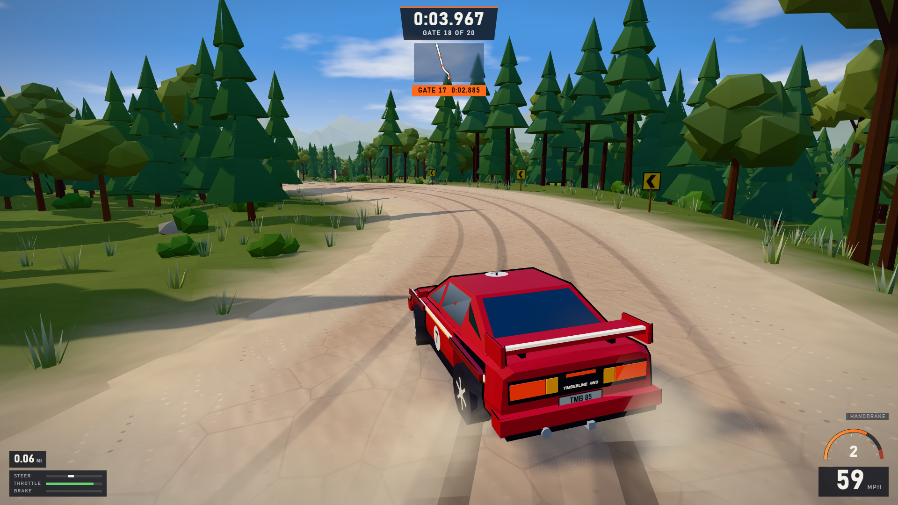

# Timberline Rally

Timberline Rally is a stylised low-poly arcade rally game that runs in the browser. It's a playable vertical slice: one car, one hand-built 3.1 km forest stage ("Black Pine Ridge") with 20 timed gates, banked corners, jumps, a lake vista and a timed finish.

It's built with **Vite + TypeScript + Three.js**. The vehicle physics are custom (a 240 Hz rigid body with four raycast suspensions and a tyre model). There are no external assets: geometry, textures and audio are all generated at runtime.



## Quick start (Windows)

Requirements:
- **Node.js 20+**. Check with `node --version`.
- A desktop browser with WebGL2 and hardware acceleration: Chrome, Edge or Firefox.

```powershell
cd rally-game
npm install
npm run dev
```

Open **http://127.0.0.1:5173** and click **Start stage** (or press Enter).

### Controls
| Action | Keyboard | Gamepad |
|---|---|---|
| Throttle | W / ↑ | Right trigger |
| Brake / reverse (hold when stopped) | S / ↓ | Left trigger |
| Steer | A D / ← → | Left stick |
| Handbrake | Space | A / RB |
| Recover to the road | R | Y |
| Camera: chase / bonnet / TV | C | X |
| Pause | Esc / P | Start |
| Mute | M | |
| 9:16 portrait preview | V | |
| Restart stage | T | Back |
| Ghost of your best run on/off | G | |
| MPH / KM/H | U | |
| Fullscreen | F | |
| FPS / draw-call overlay | F3 | |

Your personal best, gate splits, a **local top-5 leaderboard** and a **ghost car of your best run** are saved in `localStorage`. On your next attempt you race against the ghost, and split popups show the delta to your PB.

**Pause menu:**
- **Quality** cycles High / Medium / Low. It also downgrades itself once if the first seconds of driving run below 42 fps.
- **Assists** switches between *arcade* (countersteer bias, drift stabiliser, handbrake turn-in help) and *pro* (raw car).
- **Camera** and **Mute** do the same as their keys.

### Useful URL options
- `?portrait=1`: starts in the 9:16 preview.
- `?quality=low|medium|high`
- `?audio=0`
- `?debug=1`: exposes `window.__RALLY__` and `window.game`.
- `?test=1&seed=123`: automation mode. The race autostarts with no audio and the debug API is on.

## Build

```powershell
npm run build      # type-check + production bundle into dist/
npm run preview    # serve dist/ on http://127.0.0.1:4173
```

`dist/` is static, so any web server works. Opening the file from disk (`file://`) won't work, because ES modules need HTTP.

## Tests and automation

All automation drives the **real game** through the same input path a player uses. It runs headless on your GPU through the locally installed Google Chrome. To use Playwright's own Chromium instead, set `RALLY_CHANNEL=chromium` and run `npx playwright install chromium`.

```powershell
npm test                 # all Playwright specs (auto-starts the dev server)
npm run test:smoke       # boot, WebGL non-blank, controls both ways, braking, handbrake,
                         # recovery, pause/restart, grass drag, mocked gamepad, 9:16 preview
npm run test:drive       # autopilot completes all 20 gates; jump airtime; banked-corner lean
```

Scripts in `scripts/` need the dev server running (`npm run dev`). To point them at a preview build, set `RALLY_URL`.

| Script | What it does |
|---|---|
| `node scripts/capture.mjs [dir] [w] [h]` | Named gameplay screenshots: spawn, straight, bend, jump, vista, banked, drift, off-road, finish, cameras, car close-ups, portrait |
| `node scripts/capture-ui.mjs [dir]` | Title, countdown and pause screens from the normal boot path |
| `node scripts/record-demo.mjs demo.mp4` | Deterministic full-stage recording, frame by frame. Needs ffmpeg on PATH |
| `node scripts/dynamics.mjs` | Handling bench on a debug flat plane: 0–60, braking, lateral g, step steer, lift-off, handbrake, keyboard full-lock tests |
| `node scripts/explore.mjs 140 10` | Full-stage autopilot telemetry log. Add `DIGITAL=1` to emulate a keyboard driver |
| `node scripts/perf.mjs 30 1920 1080` | Real-time frame-time stats while the autopilot drives |
| `node scripts/audio-check.mjs` | Offline render of the engine synth to `docs/audio/engine-sweep.wav`, plus level and spectrum checks |

## Project layout

```
src/
  track/    stage design (turtle segments) + Track (curvature integration, banking, projection)
  world/    terrain field + meshes, road ribbon shader, forest instancing/LOD, props, sky,
            atmosphere/fog, lake
  vehicle/  VehicleSim (physics), VehicleParams (tuning), CarModel (procedural cel-shaded coupe)
  camera/   chase / bonnet / TV cameras
  vfx/      dust plumes, fading tyre marks
  audio/    AudioWorklet engine synthesiser + surface/wind/impact layers
  ui/       HUD (timer, gate, route preview, tach, MPH, inputs), menus, styles
  game/     loop, state machine, input (keyboard + gamepad), storage
  testing/  autopilot + debug/test API
tests/      Playwright specs
scripts/    capture, demo recording, dynamics bench, perf, audio checks
docs/       reference breakdown, iteration log, final review
screenshots/  real in-game captures
```

## Credits and licences
- Code, models, textures and sounds in this project are original and procedurally generated.
- Three.js (MIT), Vite (MIT), Playwright (Apache-2.0) and TypeScript (Apache-2.0) are development and runtime dependencies.
- The visual direction is inspired by gameplay footage of *Hardpack Rally*. No assets, logos, names or track data from that game are used. The reference clip is kept locally and is not part of this repository.
